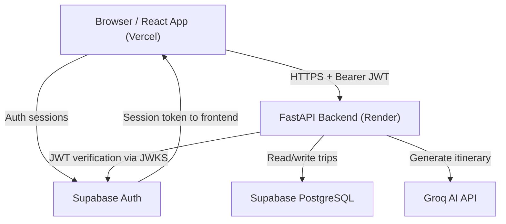

# 🌍 Wandr AI — AI Travel Itinerary Planner

> Plan your perfect trip with AI. Get a complete day-by-day itinerary with activities, dining, accommodation, and budget tracking — powered by Groq AI and Supabase.

---

## Table of Contents

1. [Overview](#overview)
2. [Live Demo and Links](#live-demo-and-links)
3. [Features](#features)
4. [Technology Stack](#technology-stack)
5. [Architecture](#architecture)
6. [Repository Structure](#repository-structure)
7. [Prerequisites](#prerequisites)
8. [Local Setup](#local-setup)
9. [Environment Variables](#environment-variables)
10. [Supabase Configuration](#supabase-configuration)
11. [Groq AI Configuration](#groq-ai-configuration)
12. [Deployment Guide](#deployment-guide)
13. [API Reference](#api-reference)
14. [Testing and Verification](#testing-and-verification)
15. [Troubleshooting](#troubleshooting)
16. [Security](#security)
17. [Disclaimer](#disclaimer)

---

## Overview

**Wandr AI** is a full-stack web application that generates personalized, day-by-day travel itineraries using an AI language model. A user describes their trip — destination, dates, budget, travel style, and interests — and the application calls a FastAPI backend, which queries the Groq AI API to produce a structured itinerary stored in a Supabase PostgreSQL database. Users can then view, edit, regenerate individual days, and track their budget through an interactive dashboard.

**Problem it solves:** Planning a detailed trip itinerary is time-consuming. Wandr AI produces a realistic, day-by-day plan with activities, dining suggestions, accommodation recommendations, transportation notes, and cost estimates in seconds.

---

## Live Demo and Links

| Resource | URL |
|---|---|
| **Frontend (Vercel)** | https://ai-travel-itinerary-planner-frontend-i97y5pqrz.vercel.app |
| **Backend API (Render)** | https://ai-travel-itinerary-planner-q6j8.onrender.com |
| **API Documentation (Swagger)** | https://ai-travel-itinerary-planner-q6j8.onrender.com/docs |
| **Backend Health Check** | https://ai-travel-itinerary-planner-q6j8.onrender.com/api/health |
| **GitHub Repository** | https://github.com/Yogita15082006/AI-Travel-Itinerary-Planner |
| **Supabase Project** | https://ilhxiwvreknixzfnsxpv.supabase.co |

> **Note:** The Render backend runs on a free tier and may take 30–60 seconds to respond after a period of inactivity (cold start). The health check endpoint is the fastest way to wake it up.

---

## Features

All features listed below are verified from the actual source code.

- **AI Itinerary Generation** — submits a trip request to Groq AI and receives a complete JSON itinerary with day titles, summaries, activities (name, category, time, cost, location, tips), dining recommendations, accommodation suggestions, and transportation notes.
- **Trip Dashboard** — authenticated users see a paginated list of their saved trips.
- **Trip Detail View** — full day-by-day itinerary with expandable activity cards and a dedicated budget breakdown tab.
- **Trip Editing** — update a trip's title, status, budget, accommodation preference, dietary preferences, accessibility requirements, and additional instructions.
- **Day Regeneration** — regenerate a single itinerary day via AI without touching other days.
- **Budget Tracking** — per-day and total cost calculations, budget utilisation percentage, and notes about missing cost estimates.
- **User Authentication** — email/password signup and login powered by Supabase Auth, with JWT verification on every protected backend endpoint.
- **Protected Routes** — the frontend redirects unauthenticated users to `/login` before they can access `/dashboard`, `/trips`, or any trip page.
- **Profile Page** — view account information.
- **Row Level Security** — Supabase RLS ensures each user can only read and modify their own trips.

---

## Technology Stack

### Frontend

| Technology | Version | Purpose |
|---|---|---|
| React | 18.3.x | UI framework |
| TypeScript | ~5.6.x | Type safety |
| Vite | ^5.4 | Dev server and bundler |
| React Router DOM | ^6.26 | Client-side routing |
| Tailwind CSS | ^3.4 | Utility-first styling |
| Supabase JS | ^2.45 | Auth session management |
| React Hook Form + Zod | ^7.53 / ^3.23 | Form handling and validation |
| Recharts | ^2.12 | Budget charts |
| Lucide React | ^0.451 | Icons |
| date-fns | ^3.6 | Date formatting |

### Backend

| Technology | Version | Purpose |
|---|---|---|
| Python | 3.12 | Runtime (pinned via `.python-version`) |
| FastAPI | 0.115.0 | REST API framework |
| Uvicorn | 0.30.6 | ASGI server |
| Pydantic / pydantic-settings | 2.11.x | Schema validation and settings |
| Groq SDK | 0.11.0 | AI itinerary generation |
| Supabase Python | 2.33.0 | Database client |
| PyJWT | >=2.12.0 | JWT verification (Supabase tokens) |
| Tenacity | 9.0.0 | Retry logic for Groq API calls |
| python-dotenv | 1.0.1 | Local `.env` loading |

### Infrastructure

| Service | Purpose |
|---|---|
| Supabase | PostgreSQL database + Auth + Row Level Security |
| Groq | AI language model API |
| Vercel | Frontend hosting |
| Render | Backend hosting |

---

## Architecture



**Request flow for itinerary generation:**

1. User fills the trip form in the React app and clicks **Generate Itinerary**.
2. Frontend calls `POST /api/trips/generate` with a `Bearer` JWT from the Supabase session.
3. FastAPI verifies the JWT via Supabase's JWKS endpoint (or shared JWT secret as fallback).
4. `ai_service.py` builds a structured prompt and calls the Groq API.
5. The JSON response is parsed, validated by Pydantic, and saved to Supabase.
6. The saved `Trip` object is returned to the frontend and displayed.

**Local development proxy:**
Vite proxies all `/api/*` requests from `localhost:5173` to `localhost:8000`, so no CORS configuration is needed locally.

---

## Repository Structure

```
AI-Travel-Itinerary-Planner/
└── 7. Project Documentattion/        <- all application code lives here
    ├── SETUP.md                      <- quick-start setup guide
    │
    ├── backend/                      <- FastAPI Python backend
    │   ├── app/
    │   │   ├── api/
    │   │   │   ├── __init__.py       <- registers /api router
    │   │   │   └── routes/
    │   │   │       ├── health.py     <- GET /api/health
    │   │   │       └── trips.py      <- all /api/trips/* endpoints
    │   │   ├── core/
    │   │   │   ├── config.py         <- pydantic-settings (all env vars)
    │   │   │   └── security.py       <- JWT verification (JWKS + HS256)
    │   │   ├── db/                   <- Supabase client initialization
    │   │   ├── schemas/
    │   │   │   └── trip.py           <- all Pydantic request/response models
    │   │   └── services/
    │   │       ├── ai_service.py     <- Groq API integration + prompt builder
    │   │       ├── budget_service.py <- budget calculation logic
    │   │       └── itinerary_service.py <- trip CRUD via Supabase
    │   ├── migrations/
    │   │   └── 001_initial_schema.sql <- Supabase schema (run once manually)
    │   ├── tests/
    │   │   └── test_main.py          <- pytest test suite (34 tests)
    │   ├── .env.example              <- backend env variable template
    │   ├── .python-version           <- pins Python 3.12 for Render
    │   └── requirements.txt          <- pinned Python dependencies
    │
    └── frontend/                     <- React + Vite + TypeScript frontend
        ├── src/
        │   ├── components/
        │   │   ├── layout/           <- AppLayout, sidebar, navigation
        │   │   ├── trip/             <- BudgetPanel, trip-specific UI
        │   │   └── ui/               <- shared UI components
        │   ├── contexts/
        │   │   └── AuthContext.tsx   <- Supabase session management
        │   ├── hooks/                <- custom React hooks
        │   ├── lib/
        │   │   ├── api.ts            <- typed API client (all backend calls)
        │   │   └── supabase.ts       <- Supabase client initialization
        │   ├── pages/                <- one file per route
        │   └── types/                <- shared TypeScript type definitions
        ├── .env.local.example        <- frontend env variable template
        ├── package.json
        ├── tailwind.config.js
        ├── tsconfig.json
        └── vite.config.ts            <- Vite config with /api proxy to :8000
```

---

## Prerequisites

| Tool | Minimum Version | Notes |
|---|---|---|
| Node.js | 18.x | 20.x or 22.x recommended |
| npm | 9.x | Comes with Node.js |
| Python | 3.12.x | Pinned in `.python-version`; other versions are not tested |
| Git | any | |

You will also need free accounts on:
- [Supabase](https://supabase.com)
- [Groq](https://console.groq.com)

---

## Local Setup

All commands assume you start from the repository root. The application code lives inside `7. Project Documentattion/`.

### 1. Clone the repository

```bash
git clone https://github.com/Yogita15082006/AI-Travel-Itinerary-Planner.git
cd AI-Travel-Itinerary-Planner
```

### 2. Set up the backend

```bash
cd "7. Project Documentattion/backend"

# Create a virtual environment
python -m venv .venv

# Activate — Windows (PowerShell)
.venv\Scripts\Activate.ps1

# Activate — macOS / Linux
source .venv/bin/activate

# Install dependencies
pip install -r requirements.txt
```

Configure backend environment variables:

```bash
# Windows
copy .env.example .env

# macOS / Linux
cp .env.example .env
```

Edit `.env` and fill in your values (see [Environment Variables](#environment-variables)).

Start the backend:

```bash
uvicorn app.main:app --reload --host 0.0.0.0 --port 8000
```

- API: `http://localhost:8000`
- Swagger docs: `http://localhost:8000/docs`

### 3. Set up the frontend

Open a **new terminal** (keep the backend running):

```bash
cd "7. Project Documentattion/frontend"

npm install
```

Configure frontend environment variables:

```bash
# Windows
copy .env.local.example .env.local

# macOS / Linux
cp .env.local.example .env.local
```

Edit `.env.local` and fill in your Supabase URL and anon key.

Start the frontend:

```bash
npm run dev
```

App is available at `http://localhost:5173`. Vite proxies all `/api/*` requests to `http://localhost:8000` — `VITE_API_BASE_URL` can be left empty for local development.

### 4. Verify both services

Visit `http://localhost:8000/api/health`. Expected response when fully configured:

```json
{
  "status": "ok",
  "version": "1.0.0",
  "supabase_configured": true,
  "ai_configured": true,
  "auth_configured": true,
  "environment": "development"
}
```

Visit `http://localhost:5173` — you should see the Wandr AI landing page.

---

## Environment Variables

### Backend — `7. Project Documentattion/backend/.env`

Copy from `.env.example`. **Never commit this file** (it is already gitignored).

```env
# Supabase Dashboard -> Project Settings -> API
SUPABASE_URL=https://YOUR_PROJECT_REF.supabase.co
SUPABASE_ANON_KEY=your_supabase_anon_key_here
SUPABASE_SERVICE_ROLE_KEY=your_supabase_service_role_key_here
SUPABASE_JWT_SECRET=your_supabase_jwt_secret_here

# https://console.groq.com -> API Keys
GROQ_API_KEY=gsk_your_groq_api_key_here
GROQ_MODEL=openai/gpt-oss-120b

FRONTEND_ORIGIN=http://localhost:5173
ENVIRONMENT=development
LOG_LEVEL=INFO

AI_RATE_LIMIT_PER_HOUR=10
AI_REQUEST_TIMEOUT=120
```

| Variable | Required | Where to find | Secret? |
|---|---|---|---|
| `SUPABASE_URL` | Yes | Supabase -> Settings -> API -> Project URL | No |
| `SUPABASE_ANON_KEY` | Yes | Supabase -> Settings -> API -> anon public key | No (safe for server) |
| `SUPABASE_SERVICE_ROLE_KEY` | Yes | Supabase -> Settings -> API -> service_role | **Yes — never expose** |
| `SUPABASE_JWT_SECRET` | Yes | Supabase -> Settings -> API -> JWT Settings | **Yes — never expose** |
| `GROQ_API_KEY` | Yes | https://console.groq.com -> API Keys | **Yes — never expose** |
| `GROQ_MODEL` | Optional | Defaults to `openai/gpt-oss-120b` | No |
| `FRONTEND_ORIGIN` | Yes in prod | Your deployed Vercel URL (no trailing slash) | No |
| `ENVIRONMENT` | Yes in prod | Set to `production` on Render | No |

---

### Frontend — `7. Project Documentattion/frontend/.env.local`

Copy from `.env.local.example`. **Never commit this file** (it is already gitignored).

```env
# Supabase Dashboard -> Project Settings -> API
VITE_SUPABASE_URL=https://YOUR_PROJECT_REF.supabase.co
VITE_SUPABASE_ANON_KEY=your_supabase_anon_key_here

# Leave empty locally (Vite proxy handles /api/* -> localhost:8000)
# In Vercel, set to your Render backend URL:
# VITE_API_BASE_URL=https://ai-travel-itinerary-planner-q6j8.onrender.com
```

| Variable | Required | Notes |
|---|---|---|
| `VITE_SUPABASE_URL` | Yes | Same value as backend `SUPABASE_URL` |
| `VITE_SUPABASE_ANON_KEY` | Yes | Same as backend `SUPABASE_ANON_KEY` — safe for browser use |
| `VITE_API_BASE_URL` | Production only | Empty locally; set to Render URL in Vercel |

> **Warning:** Never add `SUPABASE_SERVICE_ROLE_KEY`, `SUPABASE_JWT_SECRET`, or `GROQ_API_KEY` to any `VITE_` variable or any frontend file.

---

## Supabase Configuration

### Step 1 — Create a project

1. Sign in at [supabase.com](https://supabase.com) and click **New Project**.
2. Choose a name, set a database password, and select a region.
3. Wait ~1 minute for provisioning.

### Step 2 — Enable Email Authentication

1. Supabase Dashboard -> **Authentication -> Providers -> Email**
2. Ensure the **Email** provider is enabled (on by default).
3. For local testing, you may disable **Confirm email** to skip email verification. Re-enable before going to production.

### Step 3 — Configure redirect URLs (production)

1. Supabase Dashboard -> **Authentication -> URL Configuration**
2. Add your Vercel URL to **Redirect URLs**, for example:
   `https://ai-travel-itinerary-planner-frontend-i97y5pqrz.vercel.app/**`

### Step 4 — Run the database migration

This is a **one-time step** per Supabase project.

1. Supabase Dashboard -> **SQL Editor**
2. Paste the entire contents of `7. Project Documentattion/backend/migrations/001_initial_schema.sql`
3. Click **Run**

The migration creates:

- `public.trips` table — UUID primary key, JSONB itinerary storage, all preference and date columns
- RLS policies — users can only read/write/delete their own trips
- Performance indexes: `idx_trips_user_id`, `idx_trips_status`, `idx_trips_dates`
- `set_trips_updated_at` trigger — auto-updates `updated_at` on every row modification

### Step 5 — Collect credentials

From **Supabase -> Project Settings -> API**:
- **Project URL** -> `SUPABASE_URL` (backend) and `VITE_SUPABASE_URL` (frontend)
- **anon public key** -> `SUPABASE_ANON_KEY` (backend) and `VITE_SUPABASE_ANON_KEY` (frontend)
- **service_role key** -> `SUPABASE_SERVICE_ROLE_KEY` (backend only)

From **Supabase -> Project Settings -> API -> JWT Settings**:
- **JWT Secret** -> `SUPABASE_JWT_SECRET` (backend only)

---

## Groq AI Configuration

### Obtain an API key

1. Sign in at [console.groq.com](https://console.groq.com) or create a free account.
2. Go to **API Keys** in the left sidebar.
3. Click **Create API Key**, name it, and copy the value (starts with `gsk_`).
4. Set it as `GROQ_API_KEY` in `backend/.env` and in Render's environment variables.

### Model

The backend uses model **`openai/gpt-oss-120b`** — configured as the default in `app/core/config.py` and overridable via the `GROQ_MODEL` environment variable. The model is called with `temperature=0.7`, `max_tokens=8000`, and up to 3 retries with exponential backoff on timeout and rate-limit errors.

> The previously documented model `llama-3.3-70b-versatile` is deprecated and returns HTTP 404 from the Groq API. Do not use it.

---

## Deployment Guide

### Frontend — Vercel

1. Connect your GitHub repository to [Vercel](https://vercel.com).
2. Configure the project:

| Setting | Value |
|---|---|
| **Root Directory** | `7. Project Documentattion/frontend` |
| **Build Command** | `npm run build` |
| **Output Directory** | `dist` |
| **Install Command** | `npm install` |

3. Add environment variables in **Vercel -> Project -> Settings -> Environment Variables**:

| Variable | Value |
|---|---|
| `VITE_SUPABASE_URL` | your Supabase project URL |
| `VITE_SUPABASE_ANON_KEY` | your Supabase anon key |
| `VITE_API_BASE_URL` | `https://ai-travel-itinerary-planner-q6j8.onrender.com` |

4. Click **Redeploy**.

---

### Backend — Render

1. Create a new **Web Service** in [Render](https://render.com) and connect the GitHub repository.
2. Configure the service:

| Setting | Value |
|---|---|
| **Root Directory** | `7. Project Documentattion/backend` |
| **Runtime** | Python 3 (Render reads `.python-version` -> 3.12) |
| **Build Command** | `pip install -r requirements.txt` |
| **Start Command** | `uvicorn app.main:app --host 0.0.0.0 --port $PORT` |

3. Add environment variables in **Render -> Service -> Environment**:

| Variable | Value |
|---|---|
| `SUPABASE_URL` | your Supabase project URL |
| `SUPABASE_ANON_KEY` | your Supabase anon key |
| `SUPABASE_SERVICE_ROLE_KEY` | your Supabase service role key |
| `SUPABASE_JWT_SECRET` | your Supabase JWT secret |
| `GROQ_API_KEY` | your Groq API key |
| `GROQ_MODEL` | `openai/gpt-oss-120b` |
| `FRONTEND_ORIGIN` | your Vercel production URL (no trailing slash) |
| `ENVIRONMENT` | `production` |

4. Click **Save Changes** then trigger a **Manual Deploy**.

---

### Post-deployment checklist

- [ ] `GET /api/health` returns `supabase_configured: true`, `ai_configured: true`, `auth_configured: true`, `environment: "production"`
- [ ] Frontend loads at the Vercel URL without a blank screen
- [ ] Signup creates an account (check Supabase email confirmation settings)
- [ ] Login redirects to `/dashboard`
- [ ] Trip generation completes without CORS or 503 errors

---

## API Reference

Interactive Swagger documentation: **https://ai-travel-itinerary-planner-q6j8.onrender.com/docs**

All protected endpoints require:

```
Authorization: Bearer <supabase_access_token>
```

### Health

| Method | Path | Auth | Description |
|---|---|---|---|
| `GET` | `/api/health` | No | Service and configuration status |

### Trips

| Method | Path | Auth | Description |
|---|---|---|---|
| `POST` | `/api/trips/generate` | Yes | Generate and save a new AI itinerary |
| `GET` | `/api/trips` | Yes | List user's trips (`?page=1&page_size=20`) |
| `GET` | `/api/trips/{trip_id}` | Yes | Get a single trip |
| `PATCH` | `/api/trips/{trip_id}` | Yes | Update trip metadata |
| `DELETE` | `/api/trips/{trip_id}` | Yes | Delete a trip |
| `PATCH` | `/api/trips/{trip_id}/days/{day_id}` | Yes | Update a single itinerary day |
| `POST` | `/api/trips/{trip_id}/days/{day_id}/regenerate` | Yes | Regenerate one day via AI |
| `GET` | `/api/trips/{trip_id}/budget` | Yes | Budget breakdown for a trip |

### Example — Generate a trip

```bash
curl -X POST https://ai-travel-itinerary-planner-q6j8.onrender.com/api/trips/generate \
  -H "Authorization: Bearer YOUR_SUPABASE_TOKEN" \
  -H "Content-Type: application/json" \
  -d '{
    "destination": "Tokyo, Japan",
    "start_date": "2025-04-01",
    "end_date": "2025-04-07",
    "travelers": 2,
    "total_budget": 3000,
    "currency": "USD",
    "travel_style": "cultural",
    "interests": ["food", "history", "sightseeing"],
    "daily_pace": "moderate"
  }'
```

Valid `travel_style` values: `budget`, `balanced`, `luxury`, `adventure`, `relaxed`, `cultural`, `romantic`
Valid `daily_pace` values: `slow`, `moderate`, `fast`

---

## Testing and Verification

### Run the backend test suite

```bash
# From: 7. Project Documentattion/backend/
pytest tests/test_main.py -v
```

The suite covers: health endpoint, schema validation, budget calculations, AI response parsing, authentication, and CORS behaviour. Expected result: **34 tests pass**.

### Verify the backend health endpoint

```bash
# Local
curl http://localhost:8000/api/health

# Production
curl https://ai-travel-itinerary-planner-q6j8.onrender.com/api/health
```

Expected when fully configured:

```json
{
  "status": "ok",
  "version": "1.0.0",
  "supabase_configured": true,
  "ai_configured": true,
  "auth_configured": true,
  "environment": "production"
}
```

### Verify the frontend build

```bash
# From: 7. Project Documentattion/frontend/
npm run build
```

Should complete with no TypeScript or Vite errors.

---

## Troubleshooting

### CORS error — No `Access-Control-Allow-Origin` header

**Cause:** `FRONTEND_ORIGIN` on Render does not match the actual Vercel URL, or is not set.
**Fix:** Set `FRONTEND_ORIGIN=https://your-vercel-url.vercel.app` in Render -> Environment. The CORS middleware automatically accepts all Vercel preview deployments for this project (`https://ai-travel-itinerary-planner-frontend-*.vercel.app`), so individual preview URLs do not need to be listed separately.

---

### Backend 503 or slow first response (cold start)

**Cause:** Render free-tier services spin down after ~15 minutes of inactivity.
**Fix:** Wait 30-60 seconds and retry. Open the health check URL first to wake the service. For production, consider a paid Render plan to eliminate cold starts.

---

### `supabase_configured: false` in health check

**Cause:** `SUPABASE_URL` or `SUPABASE_ANON_KEY` is missing or empty in Render's environment.
**Fix:** Verify both values in Render -> Environment. Check for trailing spaces (a common paste error).

---

### `auth_configured: false` in health check

**Cause:** Both `SUPABASE_JWT_SECRET` and `SUPABASE_URL` are absent.
**Fix:** Set `SUPABASE_JWT_SECRET` from Supabase -> Settings -> API -> JWT Settings. If `SUPABASE_URL` is already set and non-empty, `auth_configured` will also be `true`.

---

### Groq 404 — model not found

**Cause:** `GROQ_MODEL` is set to the deprecated `llama-3.3-70b-versatile`.
**Fix:** Update the environment variable or remove it to use the default:

```
GROQ_MODEL=openai/gpt-oss-120b
```

---

### Supabase signup does not deliver a confirmation email

**Cause:** Supabase free-tier rate-limits outgoing emails to a few per hour.
**Fix (development):** Disable **Confirm email** in Supabase -> Authentication -> Providers -> Email.
**Fix (production):** Configure a custom SMTP provider in Supabase -> Project Settings -> Authentication -> SMTP Settings.

---

### `environment: "development"` in production health check

**Cause:** `ENVIRONMENT` is not set in Render's environment.
**Fix:** Add `ENVIRONMENT=production` in Render -> Service -> Environment.

---

### Frontend blank page after Vercel deployment

**Cause:** `VITE_SUPABASE_URL`, `VITE_SUPABASE_ANON_KEY`, or `VITE_API_BASE_URL` is missing in Vercel.
**Fix:** Check Vercel -> Project -> Settings -> Environment Variables, add the missing values, and redeploy.

---

### Python version errors during Render build

**Cause:** Render may select a newer Python version if the root directory is misconfigured.
**Fix:** Ensure Render's **Root Directory** is `7. Project Documentattion/backend`. The `.python-version` file (containing `3.12`) is in that directory and Render uses it to select the runtime.

---

## Security

- **`.env` files are gitignored.** Both `backend/.gitignore` and `frontend/.gitignore` exclude all `.env*` files. Never remove these rules or commit secret values.
- **Public vs. server-only keys:** `SUPABASE_ANON_KEY` is a publishable key safe for browser use. `SUPABASE_SERVICE_ROLE_KEY`, `SUPABASE_JWT_SECRET`, and `GROQ_API_KEY` are server-only secrets. They must never appear in `VITE_` variables, browser code, GitHub, or this README.
- **Secret rotation:** If a secret is accidentally committed, rotate it immediately in the Supabase or Groq dashboard, then update Render environment variables. The exposed value is invalidated as soon as it is rotated.
- **JWT verification:** The backend verifies every Supabase JWT using the JWKS endpoint (asymmetric ES256/RS256) with HS256 fallback when `SUPABASE_JWT_SECRET` is provided. All protected routes require a valid, non-expired token.
- **Row Level Security:** Supabase RLS policies enforce database-level isolation — no user can read or modify another user's trips even if they bypass the API.

---

## Disclaimer

All itinerary content, cost estimates, activity descriptions, accommodation suggestions, and recommendations are AI-generated and may be inaccurate, outdated, or unavailable. Always verify information with official sources before making any travel bookings or financial commitments.

---

## License

No license file is present in this repository. All rights reserved by the repository owner unless otherwise stated.
